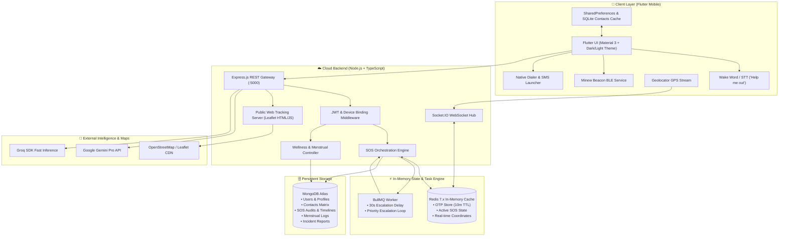
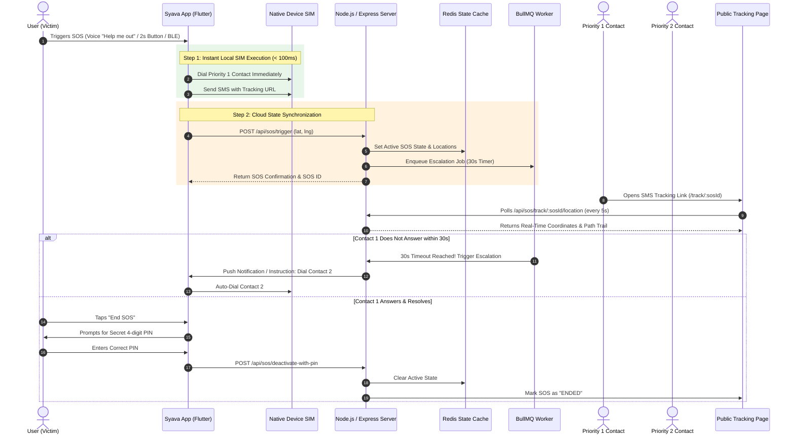
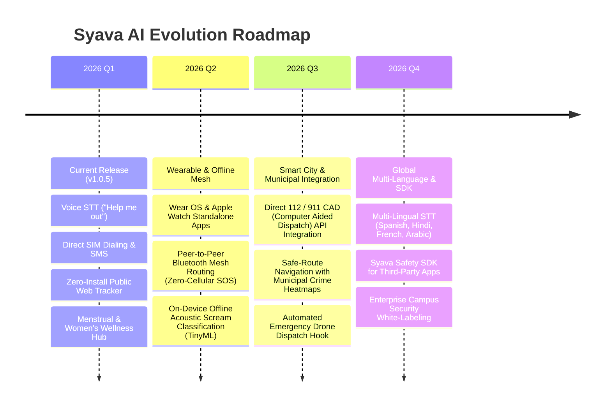

# 🛡️ SYAVA AI (VHASS) — PRODUCT ARCHITECTURE & SPECIFICATION MANUAL
> **Voice-activated Health and Safety System (VHASS)**  
> *Tagline:* "You're safe with us 💜"  
> *Target Ecosystem:* Mobile (Flutter Android/iOS) • Cloud Backend (Node.js/TypeScript) • Hardware IoT (BLE Panic Beacons) • AI Intelligence (Google Gemini & Groq)

---

## 📑 TABLE OF CONTENTS
1. [Executive Summary & Visual Overview](#1-executive-summary--visual-overview)
2. [The Core Problem & Syava's Innovation](#2-the-core-problem--syavas-innovation)
3. [System Architecture & Data Topology](#3-system-architecture--data-topology)
4. [The 4 Product Pillars (Deep Dive)](#4-the-4-product-pillars-deep-dive)
   - [Pillar 1: Multi-Modal Emergency SOS Engine](#pillar-1-multi-modal-emergency-sos-engine)
   - [Pillar 2: Syava AI Companion & Crisis Intelligence](#pillar-2-syava-ai-companion--crisis-intelligence)
   - [Pillar 3: Holistic Women’s Wellness & Menstrual Health Hub](#pillar-3-holistic-womens-wellness--menstrual-health-hub)
   - [Pillar 4: Institutional & Campus Security Command Portal](#pillar-4-institutional--campus-security-command-portal)
5. [End-to-End User Experience & Flow Diagrams](#5-end-to-end-user-experience--flow-diagrams)
6. [Complete Technical Specification](#6-complete-technical-specification)
   - [API Endpoint Catalog](#api-endpoint-catalog)
   - [WebSocket Event Schema](#websocket-event-schema)
   - [Database & State Architecture](#database--state-architecture)
   - [Device-SIM Calling & SMS Engine](#device-sim-calling--sms-engine)
7. [Security, Privacy & Anti-Coercion Safeguards](#7-security-privacy--anti-coercion-safeguards)
8. [Competitive Differentiation Matrix](#8-competitive-differentiation-matrix)
9. [Deployment & Infrastructure Topology](#9-deployment--infrastructure-topology)
10. [Product Roadmap](#10-product-roadmap)

---

## 1. EXECUTIVE SUMMARY & VISUAL OVERVIEW

**Syava AI** (engineered under the **VHASS** initiative) is an all-in-one personal safety, emergency response, women’s health tracking, and institutional security ecosystem. It bridges the gap between digital personal safety and physical rapid response by unifying **hands-free voice triggering**, **carrier-grade SIM execution**, **real-time GPS radar streaming**, **AI health assistance**, and **enterprise campus guard dispatch** into a single cohesive platform.

```
┌─────────────────────────────────────────────────────────────────────────────┐
│                            SYAVA AI AT A GLANCE                             │
├─────────────────────┬─────────────────────┬─────────────────────────────────┤
│ 🚨 EMERGENCY SOS    │ 🌸 WOMEN'S WELLNESS │ 🤖 AI COMPANION                 │
│ • "Help me out" STT │ • Period/Ovulation  │ • Google Gemini + Groq          │
│ • 2s Hold Panic Btn │ • Symptom Analytics │ • Crisis De-escalation          │
│ • Minew BLE Beacon  │ • Restorative Yoga  │ • 24/7 Health Counseling        │
│ • SIM Direct Dial   │ • Counselor Booking │ • Multimodal Context            │
├─────────────────────┴─────────────────────┴─────────────────────────────────┤
│ 🛡️ CAMPUS & INSTITUTIONAL SECURITY COMMAND PORTAL                          │
│ • Live Guard Roster • Incident Investigation • QR Access • Live SOS Radar   │
└─────────────────────────────────────────────────────────────────────────────┘
```

### Key Metrics & Architectural Pillars
| Metric / Attribute | Specification | Strategic Rationale |
| :--- | :--- | :--- |
| **SOS Activation Latency** | **< 1.0 Second** | Initiates calls & SMS instantly from device SIM cache without waiting for remote server round-trip |
| **Calling / SMS Cost** | **$0.00 (Zero API Fees)** | Bypasses costly third-party VoIP (Twilio/Vonage) via device carrier SIM execution |
| **Public Tracking** | **Zero-Install Web Radar** | Emergency SMS delivers a lightweight Leaflet.js URL; contacts track victim live in any web browser |
| **Deactivation Security** | **4–6 Digit Duress PIN** | Prevents assailants from forcing the victim to silence or dismiss active emergency broadcasts |
| **Offline Resilience** | **Local Cache First** | Contacts pre-fetched and stored locally in SQLite/SharedPreferences; SOS triggers even with zero internet |

---

## 2. THE CORE PROBLEM & SYAVA'S INNOVATION

Current personal safety and wellness tools fail users when real emergencies strike:

```mermaid
graph TD
    subgraph Legacy Failure Modes
        A[Assailant Attacks Victim] --> B[Victim Cannot Unlock Phone]
        B --> C[Third-Party SMS Gateway Fails or Delays]
        C --> D[Contacts Must Have Same App Installed]
        D --> E[Attacker Forces Dismissal of Alert]
    end

    subgraph Syava AI Innovation
        A2[Assailant Attacks Victim] --> B2[Hands-Free Voice 'Help me out' OR BLE Button]
        B2 --> C2[Carrier-Direct SIM Dialing + SMS Dispatched Instantly]
        C2 --> D2[Public Web Tracking Link: Zero-Install Live GPS Map]
        D2 --> E2[Protected by Anti-Coercion Secret PIN & Biometrics]
    end

    style Legacy Failure Modes fill:#ffebee,stroke:#c62828,stroke-width:2px
    style Syava AI Innovation fill:#e8f5e9,stroke:#2e7d32,stroke-width:2px
```



### The 4 Pillars of Syava's Advantage:
1. **Multi-Vector Triggering**: Users can trigger an emergency by vocalizing **"Help me out"**, pressing the prominent 2-second in-app panic button, or clicking a paired physical **Minew BLE wearable beacon**.
2. **Deterministic SIM Dialing**: Rather than relying on cloud VoIP relays that require reliable cellular data, Syava commands the mobile OS to dial emergency contacts sequentially or launch emergency broadcasts directly via the device's native carrier SIM.
3. **Frictionless Public Tracking Webview**: When an alert fires, emergency contacts receive an SMS with a direct URL (`/track/:sosId`). They do not need to download the app, create an account, or log in; an interactive, real-time Leaflet map renders the victim's breadcrumbs and auto-refreshes every 5 seconds.
4. **Holistic Daily Engagement (Beyond Emergencies)**: Unlike one-dimensional panic apps that users forget or delete, Syava provides daily value through menstrual health tracking, supportive health notifications (hydration, posture), yoga modules, AI conversation, and campus safety services.

---

## 3. SYSTEM ARCHITECTURE & DATA TOPOLOGY

Syava AI implements a decoupled **Client-Decides-and-Executes / Cloud-Orchestrates** distributed pattern.



---

## 4. THE 4 PRODUCT PILLARS (DEEP DIVE)

### PILLAR 1: Multi-Modal Emergency SOS Engine
The emergency system is designed for high-stress situations where fine motor control is compromised.

```
       [Voice Wake Word: "Help me out"] 
                       │
  [In-App 2s Hold] ────┼──── [Minew BLE Panic Beacon]
                       │
                       ▼
             ┌───────────────────┐
             │ SOS Engine Fires  │
             └─────────┬─────────┘
                       │
       ┌───────────────┴───────────────┐
       ▼                               ▼
[Local Native Execution]      [Backend Cloud State]
 ├─ Start GPS Geo-Tracking     ├─ Create SOS in MongoDB
 ├─ Call Contact 1 (SIM)       ├─ Register Active SOS in Redis
 ├─ Send SMS with Track Link   ├─ Enqueue BullMQ Escalation Job
 └─ Sound Critical Alarm       └─ Stream GPS on Socket.IO Room
```

#### Key Capabilities:
- **Instant Trigger Vectors**:
  - **Voice Wake-Word Detection**: Listens continuously or via dedicated voice command screen for trigger keywords (`"help me out"`, `"help me"`).
  - **Press-and-Hold Button**: Tactile, animated ripple button requiring a 2-second hold to avoid false triggers while ensuring deliberate activation.
  - **Bluetooth Low Energy (BLE) Wearables**: Pairs with physical beacons (such as Minew Beacon Plus). Clicking the button hardware alerts the phone over BLE even if the phone is tucked in a pocket or bag.
- **Priority Escalation Sequence**:
  1. Contacts are prioritized from **Priority 1 (Highest)** to **Priority 3**.
  2. The mobile phone dials Priority 1 immediately via the device's native carrier SIM.
  3. BullMQ starts a **30-second delay countdown**. If Priority 1 does not answer or confirm safety, the backend auto-escalates to Priority 2, then Priority 3, and ultimately dials national emergency services (**112**).
- **Public Interactive Web Tracking (`/track/:sosId`)**:
  - SMS messages sent to contacts include: `🚨 EMERGENCY: [User] needs help! Track live: https://vhass.app/track/65...`.
  - Recipient clicks the link to open an interactive Leaflet map in Safari, Chrome, or any mobile browser.
  - Auto-polls live coordinates every 5 seconds, displaying movement trails, GPS accuracy radius, and a one-tap button to call 112.
- **Anti-Coercion Security PIN**:
  - To cancel or resolve an emergency, the user must input their secret **4–6 digit security PIN** or authenticate with biometrics (fingerprint/face).
  - An assailant cannot simply tap "Cancel" or "I am safe" to abort police and guardian notification.

---

### PILLAR 2: Syava AI Companion & Crisis Intelligence
Syava features a built-in conversational AI assistant tailored for immediate reassurance, crisis de-escalation, and wellness advice.

```
 ┌─────────────────┐       ┌────────────────────────┐       ┌─────────────────┐
 │ User Voice/Chat │ ───▶  │ Node.js AI Gateway     │ ───▶  │ Gemini Pro /    │
 │ "I'm having a   │       │ Context Injection:     │       │ Groq Llama 3    │
 │ panic attack"   │       │ - Safe Tone Directive  │       │ Ultra-Low       │
 └─────────────────┘       │ - Emergency Protocol   │       │ Latency Stream  │
                           └────────────────────────┘       └────────┬────────┘
                                                                     │
 ┌────────────────────────────────────────────────────────┐          │
 │ Interactive Guidance: Breathing Exercises, GPS Alert   │ ◀────────┘
 └────────────────────────────────────────────────────────┘
```

#### Core AI Functions:
- **Crisis De-escalation & Mental Calming**: Provides grounded, step-by-step 4-7-8 breathing exercises and reassuring protocols during panic or anxiety.
- **Emergency Action Protocols**: Immediate guidance on what to do if being followed, medical first aid for injuries, burn treatments, or fainting protocols.
- **Dual Engine Architecture**: Defaults to **Google Gemini Pro** for rich, empathetic multi-turn wellness conversations, with instant fallback to **Groq SDK** for sub-second inference speeds.
- **Strict Guardrails**: Explicit system instructions prohibit medical diagnosis, directing users to professional medical services and campus hotlines when clinical risks appear.

---

### PILLAR 3: Holistic Women’s Wellness & Menstrual Health Hub
Syava provides daily utility through a clinical-grade Menstrual Health & Lifestyle tracking suite designed with privacy and aesthetics in mind.

```
                        ┌───────────────────────────────┐
                        │     Syava Wellness Hub        │
                        └──────────────┬────────────────┘
                                       │
        ┌──────────────────────────────┼──────────────────────────────┐
        ▼                              ▼                              ▼
┌──────────────┐              ┌────────────────┐             ┌─────────────────┐
│ Period Cycle │              │ Restorative    │             │ Confidential    │
│ & Ovulation  │              │ Yoga Library   │             │ Counseling Hub  │
└───────┬──────┘              └────────┬───────┘             └────────┬────────┘
        │                              │                              │
 • 28/5 Default Cycles         • Period Cramp Relief          • Verified Doctors
 • Symptom Logging (Cramps,    • Stress Reduction Poses       • Appointment Slot
   Mood, Fatigue, Flow)        • Step-by-Step Instructions      Booking & History
 • Predictive Calendar         • Visual Pose Guides           • Anonymous Support
 • Phase-Based Nutrition
```

#### Wellness Modules:
- **Menstrual & Ovulation Predictor**:
  - Calculates follicular, ovulatory, and luteal phases.
  - Dynamic monthly calendar highlights predicted start dates, fertile windows, and ovulation peaks.
  - Daily log records flow intensity (Light, Medium, Heavy), mood spectrum, pain symptoms, and notes.
- **Smart Health & Period Notifications**:
  - Sends proactive, gentle nudges days prior to estimated period start.
  - Background reminders for daily hydration, posture breaks, and eye strain relief.
- **Restorative Yoga Module**:
  - Specialized asanas targeting menstrual cramps (Baddha Konasana, Balasana, Supta Baddha Konasana).
  - High-resolution visual diagrams, hold durations, and anatomical benefits.
- **Confidential Counselor Booking**:
  - Browse verified institutional counselors and psychologists.
  - Book 1-on-1 virtual or in-person sessions with appointment tracking.

---

### PILLAR 4: Institutional & Campus Security Command Portal
Syava bridges student/user devices directly with physical security personnel and campus management.

```
 ┌───────────────────────────────────────────────────────────────────────────┐
 │                   CAMPUS SECURITY COMMAND CENTER                          │
 ├────────────────────────────────┬──────────────────────────────────────────┤
 │ 🚨 ACTIVE INCIDENTS            │ 👮 SECURITY ROSTER & DISPATCH            │
 │ • Real-Time Alert Radar Map    │ • Morning / Evening / Night Shifts       │
 │ • Incident Category & Severity │ • Nearest Guard Location & Contact       │
 │ • Victim Contact & Live Trail  │ • Instant Guard Reallocation             │
 ├────────────────────────────────┼──────────────────────────────────────────┤
 │ 📋 INCIDENT MANAGEMENT         │ 🔍 VERIFICATION & SURVEILLANCE           │
 │ • Formal Incident Filing       │ • QR Code Visitor / Student Scan         │
 │ • Digital Evidence Attachment  │ • Vehicle Entry / Exit Logging           │
 │ • Assigned Investigator Status │ • Campus Lost & Found Registry           │
 └────────────────────────────────┴──────────────────────────────────────────┘
```

#### Security Capabilities:
- **Emergency Command Center**: Displays all active campus SOS alerts on a centralized radar dashboard for dispatchers.
- **Guard Duty Roster**: Tracks guard locations across zones (Main Gate, Hostels, Library Block) and shift availability.
- **Incident Escalation Matrix**: When an on-campus SOS triggers, the backend alerts the nearest guard first, escalating to the Supervisor and Security Head if unacknowledged within 60 seconds.
- **QR Visitor Verification**: Campus gates scan visitor and contractor QR passes directly in-app for rapid security clearance.

---

## 5. END-TO-END USER EXPERIENCE & FLOW DIAGRAMS

### Primary User Flow: The Emergency Response Cycle



---

## 6. COMPLETE TECHNICAL SPECIFICATION

### API Endpoint Catalog

#### Authentication & Profiles (`/api/auth`)
| Method | Endpoint | Auth | Description |
| :--- | :--- | :--- | :--- |
| `POST` | `/api/auth/send-otp` | Public | Generates 6-digit OTP stored in Redis (10 min TTL) |
| `POST` | `/api/auth/verify-otp` | Public | Validates OTP, issues JWT, binds `deviceId` |
| `GET` | `/api/auth/profile` | Bearer JWT | Returns user profile, emergency settings, and preferences |

#### Emergency SOS Management (`/api/sos`)
| Method | Endpoint | Auth | Description |
| :--- | :--- | :--- | :--- |
| `POST` | `/api/sos/trigger` | Bearer JWT | Activates emergency incident; returns SIM dialing instructions |
| `POST` | `/api/sos/update-location` | Bearer JWT | Ingests periodic GPS updates (lat, lng, accuracy, address) |
| `POST` | `/api/sos/report-call-result` | Bearer JWT | Mobile reports whether carrier call succeeded/failed |
| `POST` | `/api/sos/deactivate-with-pin` | Bearer JWT | Deactivates emergency upon validating the secret 4–6 digit PIN |
| `PUT` | `/api/sos/set-pin` | Bearer JWT | Sets or modifies the secret anti-coercion emergency PIN |
| `GET` | `/api/sos/status/:sosId` | Bearer JWT | Polls detailed incident status, timeline, and responders |
| `GET` | `/track/:sosId` | **Public** | **Serves self-contained Leaflet.js HTML/CSS/JS tracking webpage** |
| `GET` | `/track/:sosId/location` | **Public** | JSON endpoint consumed by tracking webpage every 5 seconds |

#### Emergency Contacts (`/api/contacts`)
| Method | Endpoint | Auth | Description |
| :--- | :--- | :--- | :--- |
| `GET` | `/api/contacts` | Bearer JWT | Lists all emergency contacts with priority ranks (1–3) |
| `POST` | `/api/contacts` | Bearer JWT | Adds new emergency contact (Validates phone, name, priority) |
| `PUT` | `/api/contacts/:id` | Bearer JWT | Updates contact details or re-orders escalation priority |
| `DELETE`| `/api/contacts/:id` | Bearer JWT | Removes contact from user matrix |

#### Women's Wellness & Menstrual Health (`/api/wellness`)
| Method | Endpoint | Auth | Description |
| :--- | :--- | :--- | :--- |
| `GET` | `/api/wellness` | Bearer JWT | Retrieves user's cycle configuration, history, and daily logs |
| `PUT` | `/api/wellness/settings` | Bearer JWT | Updates cycle length, period length, and health conditions |
| `POST` | `/api/wellness/period-log` | Bearer JWT | Logs start/end dates, flow intensity, and pain markers |
| `POST` | `/api/wellness/daily-log` | Bearer JWT | Logs daily mood, symptoms, energy levels, and hydration |
| `GET` | `/api/wellness/counsellors` | Bearer JWT | Fetches certified counselors and available booking slots |
| `POST` | `/api/wellness/appointments` | Bearer JWT | Schedules confidential 1-on-1 counseling session |

#### AI & Voice Triggering (`/api/chat` & `/api/voice`)
| Method | Endpoint | Auth | Description |
| :--- | :--- | :--- | :--- |
| `POST` | `/api/chat/message` | Bearer JWT | Multi-turn conversational endpoint powered by Gemini / Groq |
| `POST` | `/api/voice/trigger` | Bearer JWT | Validates speech recognition transcripts for panic phrases |

---

### WebSocket Event Schema (Socket.IO)

The backend exposes a high-frequency real-time WebSocket layer for live coordinate streaming and broadcast alerts.

```
Client                                      Server
  │                                            │
  │─── emit("authenticate", { token }) ───────▶│ (Validates JWT)
  │                                            │
  │─── emit("location:update", { coords }) ───▶│ (Updates Redis & Broadcasts)
  │                                            │
  │◀── on("sos:status", { status, timeline }) ─│ (Pushes escalation events)
  │                                            │
  │◀── on("sos:alert:broadcast", { alert }) ───│ (Alerts guardians & campus)
```

- **`sos:<SOS_ID>` Rooms**: Dedicated rooms created dynamically per active incident.
- **Client Emits**:
  - `authenticate`: Transmits JWT to bind socket with `userId`.
  - `location:update`: `{ sosId, latitude, longitude, accuracy, timestamp }`.
- **Server Broadcasts**:
  - `sos:status`: Emits status transitions (`TRIGGERED` → `CONTACTING` → `RESOLVED`).
  - `sos:alert:broadcast`: Alerts active guardian devices that a linked contact needs help.

---

### Database & State Architecture

```
                    ┌───────────────────────────┐
                    │       User Document       │
                    │   _id, phone, name, pin   │
                    └─────────────┬─────────────┘
                                  │ 1:N
        ┌─────────────────────────┼─────────────────────────┐
        ▼                         ▼                         ▼
┌───────────────┐         ┌───────────────┐         ┌───────────────┐
│  Contacts     │         │  SOS Incident │         │ Wellness Doc  │
│  priority 1-3 │         │  timeline,    │         │ cycleLength,  │
│  hasApp, rel  │         │  locations[]  │         │ periodLogs[]  │
└───────────────┘         └───────────────┘         └───────────────┘
```

#### MongoDB Core Collections:
1. **`users`**: Master user identity, phone number, deviceId binding, and hashed anti-coercion PIN.
2. **`contacts`**: Max 3 priority contacts with relationships, phone numbers, and app installation status.
3. **`sos`**: Complete incident audit record: start/end timestamps, triggering device, GPS coordinate history, timeline actions (`CALL_ATTEMPT`, `SMS_SENT`, `ESCALATED`), and resolution notes.
4. **`wellness`**: Menstrual cycle configuration (`cycleLength`, `periodLength`), period logs, and daily wellness journal.
5. **`counsellors` & `appointments`**: Certified health professionals, available hours, and booked consultation sessions.
6. **`logs`**: Immutable, append-only operational audit log for compliance and security forensics.

#### Redis Key Namespace:
- `otp:{phoneNumber}` — 6-digit verification code with 600-second (10-minute) TTL.
- `sos:active:{userId}` — Fast lookup of currently active SOS incident.
- `location:{sosId}` — Latest cached GPS coordinate for high-speed tracking page reads.
- `session:{token}` — Fast session authorization cache.

---

## 7. SECURITY, PRIVACY & ANTI-COERCION SAFEGUARDS

| Security Concern | Syava AI Architectural Countermeasure |
| :--- | :--- |
| **Forced Alert Dismissal** | Deactivation requires entry of a private **4–6 digit Duress PIN** or biometrics. Even if an attacker physically takes the phone, they cannot abort the ongoing alert. |
| **Device Spoofing** | JWT tokens are cryptographically bound to the device's hardware identifier (`deviceId`). Only the originating physical device can authorize cancellation. |
| **Silent Mode Blocking** | Emergency notifications utilize Android `NotificationChannel` with `IMPORTANCE_HIGH` and full-screen intents to bypass "Do Not Disturb" (DND) on guardian devices. |
| **Data Privacy (Health)** | Menstrual cycle and counselor records are strictly partitioned and encrypted; wellness records are never shared with emergency contacts during SOS. |
| **Zero Third-Party SMS Risk** | Emergency calls and SMS originate locally from the user's SIM card, preventing data breaches or service downtime associated with cloud telecom aggregators. |

---

## 8. COMPETITIVE DIFFERENTIATION MATRIX

| Feature / Dimension | Syava AI (VHASS) | Life360 | Noonlight | Traditional Panic Apps |
| :--- | :---: | :---: | :---: | :---: |
| **Hands-Free Voice Wake-Word** | 🟢 **Yes ("Help me out")** | 🔴 No | 🔴 No | 🔴 No |
| **Zero-Cost SIM Execution (No Twilio)** | 🟢 **Yes (Native SIM)** | 🔴 No (Cloud Only) | 🔴 No (Cloud Only) | 🟡 Varies |
| **Zero-Install Public Web Tracker** | 🟢 **Yes (Leaflet.js)** | 🔴 No (App Required)| 🔴 No (App Required)| 🔴 No |
| **Hardware Panic Button (BLE)** | 🟢 **Yes (Minew Beacon)** | 🔴 No | 🟡 Proprietary Only | 🔴 No |
| **Women's Cycle & Ovulation Tracker** | 🟢 **Yes (Built-in Hub)** | 🔴 No | 🔴 No | 🔴 No |
| **AI Crisis & Wellness Companion** | 🟢 **Yes (Gemini/Groq)**| 🔴 No | 🔴 No | 🔴 No |
| **Campus Security Command Portal** | 🟢 **Yes (Full Suite)** | 🔴 No | 🟡 Paid Enterprise | 🔴 No |
| **Anti-Coercion Duress PIN** | 🟢 **Yes (4–6 Digits)** | 🔴 No | 🟢 Yes (4 Digits) | 🔴 Rare |

---

## 9. DEPLOYMENT & INFRASTRUCTURE TOPOLOGY

```
                                ┌──────────────────────────┐
                                │     DNS & Cloudflare     │
                                └────────────┬─────────────┘
                                             │ HTTPS / WSS
                                             ▼
                                ┌──────────────────────────┐
                                │   Render / Cloud Run     │
                                │   Node.js + Express API  │
                                │   Socket.IO Gateway      │
                                └───────┬──────────┬───────┘
                                        │          │
                     ┌──────────────────┘          └──────────────────┐
                     ▼                                                ▼
        ┌─────────────────────────┐                      ┌─────────────────────────┐
        │      MongoDB Atlas      │                      │       Redis Cloud       │
        │  Multi-Region Database  │                      │    State & BullMQ Queue │
        └─────────────────────────┘                      └─────────────────────────┘
```

- **Mobile Client**: Compiled for Android (APK / Google Play App Bundle) and iOS (IPA / TestFlight) using Flutter 3.9.2+.
- **Backend API**: Stateless Docker container hosted on Render.com or Google Cloud Run.
- **Worker Process**: Standalone Node process (`npm run worker`) for BullMQ queue processing, ensuring background escalation timers run without affecting API responsiveness.
- **Persistent Databases**: Managed MongoDB Atlas M0/M10 cluster paired with Redis Cloud / Upstash for sub-millisecond state checks.

---

## 10. PRODUCT ROADMAP



---

*Authored by the Syava AI Core Engineering & Product Architecture Team.*  
*Current Product Version: **1.0.5+16** | System Architecture: **VHASS v2.0***
