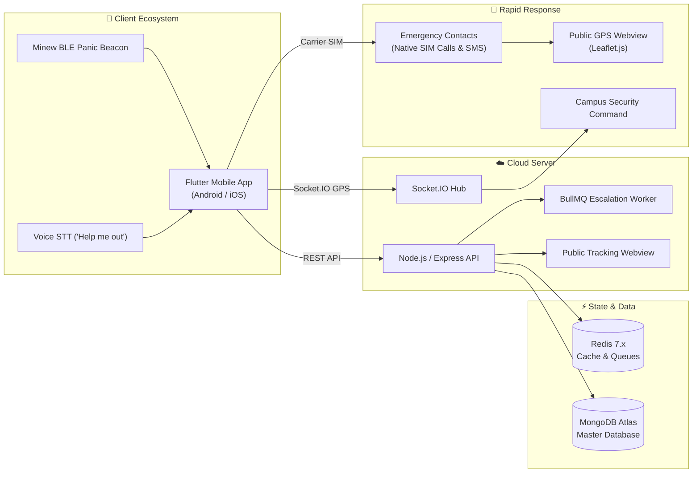

# 🛡️ Syava AI (VHASS)
### Voice-Activated Health & Safety Ecosystem
> *"You're safe with us 💜"*

[](https://flutter.dev)
[](https://nodejs.org)
[](https://www.typescriptlang.org)
[](https://mongodb.com)
[](https://redis.io)
[](https://ai.google.dev)
[]()

---

## ⚡ Quick Links & Documentation
- 📖 [Complete Product Architecture & Manual (PRODUCT_DOCUMENTATION.md)](file:///c:/dev/VHASS-APP/PRODUCT_DOCUMENTATION.md)
- 🛠️ [Full Technical Stack Deep Dive (TECH_STACK_DOCUMENTATION.md)](file:///c:/dev/VHASS-APP/TECH_STACK_DOCUMENTATION.md)
- 🎙️ [Voice & ML Engine Implementation (VOICE_IMPLEMENTATION_DETAILED.md)](file:///c:/dev/VHASS-APP/VOICE_IMPLEMENTATION_DETAILED.md)
- 📡 [Backend REST & WebSocket API Reference (backend/API_DOCUMENTATION.md)](file:///c:/dev/VHASS-APP/backend/API_DOCUMENTATION.md)

---

## 🌟 What is Syava AI?

**Syava AI** is an all-in-one personal safety, emergency response, women’s health tracking, and campus security ecosystem. Engineered under the **VHASS** (Voice-activated Health and Safety System) initiative, it pairs hands-free voice triggering and physical BLE panic beacons with zero-cost carrier SIM dialing and public live GPS breadcrumb tracking.

```
┌─────────────────────────────────────────────────────────────────────────────┐
│                            SYAVA AI AT A GLANCE                             │
├─────────────────────┬─────────────────────┬─────────────────────────────────┤
│ 🚨 EMERGENCY SOS    │ 🌸 WOMEN'S WELLNESS │ 🤖 AI COMPANION                 │
│ • "Help me out" STT │ • Period/Ovulation  │ • Google Gemini + Groq          │
│ • 2s Hold Panic Btn │ • Symptom Analytics │ • Crisis De-escalation          │
│ • Minew BLE Beacon  │ • Restorative Yoga  │ • 24/7 Health Counseling        │
│ • SIM Direct Dial   │ • Counselor Booking │ • Multimodal Context            │
├─────────────────────┴─────────────────────┴─────────────────────────────────┤
│ 🛡️ CAMPUS & INSTITUTIONAL SECURITY COMMAND PORTAL                          │
│ • Live Guard Roster • Incident Investigation • QR Access • Live SOS Radar   │
└─────────────────────────────────────────────────────────────────────────────┘
```

---

## 🚀 The 4 Core Product Pillars

### 1. 🚨 Multi-Modal Emergency SOS Engine
- **Voice Trigger**: Vocalizing `"Help me out"` triggers immediate SOS dispatch without unlocking the phone.
- **Physical Wearable Panic Beacon**: Seamless integration with **Minew Beacon Plus (BLE)** hardware for discreet one-click panic alerts.
- **Zero-Cost Carrier SIM Dialing**: Direct OS SIM execution for calls and SMS; no Twilio or third-party VoIP fees.
- **Zero-Install Public Web Radar**: Contacts receive an SMS containing an interactive tracking link (`/track/:sosId`) that displays real-time GPS breadcrumbs via Leaflet.js in any web browser.
- **Anti-Coercion Security PIN**: Requires a private 4–6 digit PIN or biometric fingerprint to cancel alerts, preventing attackers from forcing dismissal.

### 2. 🤖 Syava AI Safety & Wellness Assistant
- Powered by **Google Gemini Pro** and **Groq SDK** for sub-second, empathetic crisis management.
- Real-time 4-7-8 breathing exercises for panic attacks, medical first-aid guidance, and safe navigation protocols.

### 3. 🌸 Women's Wellness & Menstrual Health Hub
- Comprehensive period, ovulation, and fertile window forecasting with color-coded calendar views.
- Daily symptom logging (cramps, flow intensity, mood, energy levels, hydration).
- Curated restorative yoga pose library with step-by-step cramp relief asanas.
- Confidential university and mental health counselor booking portal.

### 4. 🛡️ Campus & Institutional Security Portal
- Real-time command center dashboard displaying active emergency radar.
- Guard roster management, shift planning, and automated nearest-guard dispatch.
- Incident tracking with evidence attachments and chain-of-custody assignment.
- QR-code visitor clearance and campus vehicle logging.

---

## 🏗️ High-Level Architecture



---

## 💻 Tech Stack Summary

| Layer | Technologies |
| :--- | :--- |
| **Mobile Client** | Flutter 3.9.2+, Dart 3.9.2, Material Design 3, Cupertino Icons |
| **State & Storage** | SharedPreferences, SQLite, Flutter Secure Storage |
| **Sensors & Hardware** | `geolocator`, `flutter_blue_plus` (BLE), `speech_to_text`, `battery_plus` |
| **Backend Runtime** | Node.js 18+, TypeScript 5.3.3, Express.js 4.18 |
| **Databases** | MongoDB 8.0+ (Mongoose ODM), Redis 7.x (IORedis) |
| **Real-time & Queues** | Socket.IO 4.6, BullMQ 5.3 (Redis-backed delayed job processing) |
| **Artificial Intelligence**| Google Generative AI (`@google/generative-ai`), Groq SDK (`groq-sdk`) |
| **Mapping & Radar** | Google Maps Flutter SDK, Leaflet.js (Public Webview), OpenStreetMap |

---

## 🏃 Getting Started

### 1. Backend Setup
```bash
# Navigate to backend
cd backend

# Install dependencies
npm install

# Configure environment (.env)
cp env.example .env

# Run development server
npm run dev

# In a separate terminal, launch the escalation worker
npm run worker
```

### 2. Flutter Mobile Setup
```bash
# Navigate to root
cd ..

# Fetch Flutter dependencies
flutter pub get

# Run application on connected Android/iOS device
flutter run
```

---

## 📄 Documentation Index
For an in-depth breakdown of every subsystem, see the dedicated documentation files:
- 📘 [PRODUCT_DOCUMENTATION.md](file:///c:/dev/VHASS-APP/PRODUCT_DOCUMENTATION.md) — Comprehensive product specification, user journeys, API catalog, and architectural decisions.
- 📙 [TECH_STACK_DOCUMENTATION.md](file:///c:/dev/VHASS-APP/TECH_STACK_DOCUMENTATION.md) — Detailed technical stack, dependencies, database schema, and deployment guide.
- 🎙️ [VOICE_IMPLEMENTATION_DETAILED.md](file:///c:/dev/VHASS-APP/VOICE_IMPLEMENTATION_DETAILED.md) — Complete voice recognition, wake word detection, and ML architecture.
- 📞 [CONFERENCE_CALL_PERMISSIONS.md](file:///c:/dev/VHASS-APP/docs/CONFERENCE_CALL_PERMISSIONS.md) — Telecom and SIM execution mechanics on mobile devices.

---
*Built with ❤️ & 💜 by the Syava AI Core Team.*
